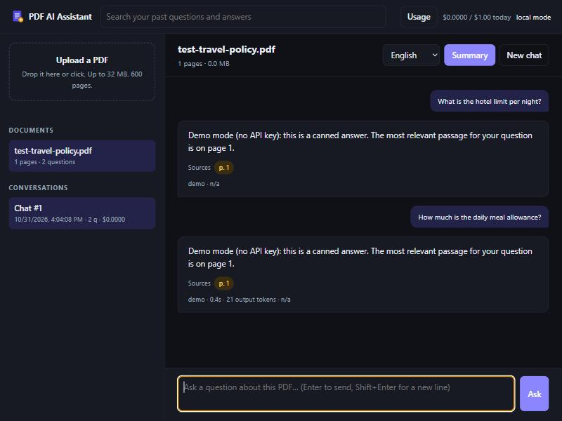

# PDF AI Assistant

**Review a contract, an invoice or a tender before you sign or pay.** Drop in the PDF and get the risks, key terms, deadlines and missing clauses, each backed by a quote that is **checked against the PDF in code**, with invoice totals **recalculated**. Then chat with the document and get answers with exact page citations. Powered by the Claude API.

**Fill in questionnaires from your approved answers.** Security questionnaires, RFPs and supplier forms are answered from the company's own answer library, kept in the database. Every answer names the library entries it came from, and questions the library doesn't cover are left for a person. It works in the browser or **unattended, from a watched folder**.

It runs as a **web app for multiple users** (FastAPI, Docker, Azure Container Apps, Azure SQL, Microsoft sign-in) and as a **command-line tool**.

## Document review

Pick a review type (**Contract**, **Invoice**, **Tender / RFP** or **Any document**) and a language. Claude reads the whole PDF and returns a report in a fixed JSON schema, enforced by the API's structured outputs:

| Section | Contract | Invoice | Tender |
|---|---|---|---|
| **Risks** with severity and what to do | auto-renewal, uncapped liability, penalties, IP transfer, exclusivity, one-sided changes | missing VAT details, short due date, **changed bank details** (a common payment-fraud pattern) | hard eligibility criteria, penalties, short timelines |
| **Key facts** | parties, value, term, notice periods, governing law | supplier, buyer, VAT numbers, IBAN, dates | authority, value, lots, award criteria |
| **Deadlines** | start, notice, delivery dates | issue and due date | submission, clarification and delivery dates |
| **Missing** | protections a contract like this normally has | mandatory invoice fields | what a bidder should ask before bidding |

**Why a company could rely on it.** A language model can misquote, and a report people act on must not contain invented evidence or wrong sums. Two checks run in code after the model answers:

- **Every quote is looked up in the PDF's own text layer** (stored per page at upload). A quote found on its page is marked *verified*. A quote found on a different page is marked *moved*, and its page number is corrected. A quote found nowhere is flagged in the UI as *not found, check this finding*. The matching ignores line breaks, hyphenation and punctuation, and allows `...` gaps. Scanned PDFs without a text layer are marked *unchecked*, not wrong.
- **Invoice arithmetic is recomputed**: quantity × unit price for each line, the sum of lines against the subtotal, and subtotal + tax against the total.

The PDF is treated as data, not instructions, so text inside a document can't redirect the review. Reports are saved, so opening one again costs nothing. You can export a report as a **CSV for Excel**, with cells escaped against formula injection, or export its deadlines as an **.ics calendar** for Outlook or Google Calendar.

Try it with the fictional samples in [`samples/`](samples): a services agreement full of one-sided clauses, and an invoice whose total is wrong and which asks for payment to a new IBAN.

## Questionnaire autofill

Companies answer the same questions again and again: *Are you ISO 27001 certified? Where is our data stored? What is your RTO?* The approved answers live in policies, certificates and past bids. This feature turns them into an **answer library**: a table of question, approved answer and source, imported from Excel or CSV and stored per user in the database. A template is provided, and Bulgarian column headers work too.

Upload a questionnaire PDF and choose **Questionnaire**. Claude finds every question and answers it **only from library entries**, citing their ids. Then code checks the result:

- **No answer without a real source.** Every cited id must exist in the library. An answer that cites no valid entry is not delivered. It becomes *needs input*, and the model's text is kept only as an unverified draft for a person to check.
- **Every question is looked up in the PDF**, the same way review quotes are, so misread or invented questions are flagged.
- Questions the library covers only partly are marked *partly answered*, with what is missing.

The result downloads as an **Excel answer sheet**, colour-coded by status, with the source of each answer, or as a CSV. Saved answers are reused for free until the library changes, which is detected by a fingerprint of the library. The library is sent as one cached prompt block, so repeated questionnaires pay about a tenth of the price for it. A library too big for one request sends the entries closest to the document.

**Unattended, from a folder.** `autofill.py` turns this into a background job. Point it at a shared folder, a OneDrive or SharePoint sync folder, or the folder where an email rule saves attachments:

```bash
python autofill.py import answer-library.xlsx            # replace the answer library
python autofill.py watch inbox --out outbox --language Bulgarian
python autofill.py run questionnaire.pdf                  # or answer a single file
```

Each new PDF in `inbox/` gets an Excel answer sheet in `outbox/` and is moved to `inbox/done/`. A file that fails is moved to `inbox/failed/`, with the reason written to a `.txt` next to it. History and cost go to the same database as the web app.

Try it with [`samples/answer-library.csv`](samples/answer-library.csv) and [`samples/supplier-questionnaire.pdf`](samples/supplier-questionnaire.pdf): a fictional supplier questionnaire where some questions are covered, some partly and some not at all.

## Chat with the document



- **Answers only from the document**, with the pages they came from. Claude's Citations API returns each quoted passage, which you can open by clicking a page chip.
- **Streams answers** word by word (server-sent events).
- **Saves every conversation** with its citations, token usage and cost. You can come back to a conversation later, search all past questions and answers, or see a usage report by document and by model.
- **Generates summaries once**, in any language, and serves them from the database afterwards at no cost.
- **Reads the whole PDF**, including tables, charts and scanned pages, through Claude's native PDF support.

## Built for a real deployment

| Concern | How it's handled |
|---|---|
| **Users and data isolation** | Sign-in through Microsoft Entra ID (Container Apps built-in auth). Every document, session, search and report is scoped to the signed-in user. Another user's document returns 404, the same as a missing one. An optional allowlist limits who can use the app. |
| **Cost control** | Each user has a daily spending limit, and the whole app has one too (HTTP 429 when reached). PDFs are uploaded once to the **Claude Files API**, so later questions send a file id instead of up to 32 MB. **Prompt caching** makes the PDF up to 20× cheaper to send again on follow-up questions, and the hit rate is shown in the usage report. |
| **No secrets in config** | The Claude API key is stored in **Key Vault** and read by the app's **managed identity**. Azure SQL sign-in uses that identity too, with no database password. CI deploys to Azure with **OpenID Connect**, so no stored credentials. |
| **Reliability** | Each answer is saved in one transaction, so a failed request, a refusal or a closed browser tab saves nothing. A connection pool replaces connections dropped by the auto-paused serverless database, and the first request waits for it to resume. Liveness (`/healthz`) and readiness (`/readyz`) probes are included. |
| **Security** | Uploads are size-limited and content-checked for a real PDF header, not just the `.pdf` extension. A strict Content-Security-Policy is set, the UI uses no inline scripts or CDN, and model output is escaped before Markdown rendering. Search is parameterized, and LIKE wildcards are escaped. The container runs as a non-root user. |
| **Observability** | Each request is logged as structured JSON with a request id that is also returned in the `X-Request-ID` header. Logs go to Log Analytics, with a daily ingestion cap. |
| **Scale to zero** | Azure Container Apps (consumption plan) with `minReplicas: 0` and the Azure SQL free offer, so the app costs about nothing while idle. |
| **Delivery** | GitHub Actions runs `ruff`, then pytest on Python 3.11–3.13, then builds the Docker image and smoke-tests it. It pushes the image to GHCR and rolls it out to Container Apps, waiting for `/readyz`. Infrastructure is defined as code in **Bicep**. |

## Architecture

```
Browser ──HTTPS──> Azure Container Apps ─────────────> Claude API
  (vanilla JS,      built-in Entra ID sign-in          Messages: streaming, citations,
   SSE streaming)   FastAPI + uvicorn (scale 0..2)       prompt caching, fallbacks
                     │   │                             Files API: each PDF uploaded once
                     │   └─ managed identity ──> Key Vault (Claude API key)
                     └─ managed identity ──────> Azure SQL Database (serverless, free offer)
                                                  documents · sessions · messages · citations
```

| File | Role |
|---|---|
| `pdf_chat.py` | Conversation engine (`PdfChat`): history, streaming, citations, cost. Also the CLI. |
| `review.py` | Document review: playbooks, the report schema, quote verification, invoice arithmetic, CSV and .ics export. |
| `questionnaire.py` | Questionnaire autofill: answer library import, the answer schema, source checks, Excel export. |
| `autofill.py` | Unattended autofill: import the library, answer one PDF, or watch a folder. |
| `storage.py` | Repository for SQLite and Azure SQL behind one interface, owner scoping, connection pool. |
| `web/app.py` | FastAPI service: auth, uploads, SSE chat, summaries, search, stats, budgets, health. |
| `web/static/` | The web UI: one HTML page, CSS and plain JavaScript, with no build step. |
| `web/demo.py` | Demo mode: a stand-in Claude client so the app can be tried without an API key. |
| `samples/` | Sample contract, invoice and questionnaire PDFs, an answer library, and the script that generates the PDFs. |
| `infra/` | Bicep template, the deploy script, and the database access grant for the managed identity. |
| `.github/workflows/ci.yml` | Lint → test matrix → Docker build and smoke test → push → deploy. |

## Run it locally

```bash
pip install -r requirements.txt
```

**Try it without an API key.** Chat answers are canned, and reviews come from simple keyword rules instead of Claude. Quotes, quote checks, arithmetic checks and exports all work on real text from your PDF:

```bash
DEMO_MODE=1 uvicorn web.app:create_app --factory --port 8000
```

**With Claude:**

```bash
export ANTHROPIC_API_KEY="your-key"      # PowerShell: $env:ANTHROPIC_API_KEY = "your-key"
uvicorn web.app:create_app --factory --port 8000
```

Open http://localhost:8000. The interactive API docs are at `/api/docs`.

**With Docker:**

```bash
docker compose up --build
```

## Deploy to Azure

Requires the Azure CLI (`az login`) and an Azure SQL database, for example on the free offer.

1. Push to `main`. CI publishes the image to `ghcr.io/<owner>/pdf-ai-chatbot`. Make the package public, or give the app pull credentials.
2. Run the deploy script:

```powershell
./infra/deploy.ps1 -ResourceGroup rg-pdf-ai -SqlServer <server-name> -SqlDatabase <db> `
    -Image ghcr.io/<owner>/pdf-ai-chatbot:latest -AllowedUsers "you@example.com"
```

On the first run, the script creates the Key Vault and stops so you can add the API key yourself:
`az keyvault secret set --vault-name <vault> --name anthropic-api-key --value (Read-Host 'API key')`.
Then run it again. It gives the app's identity access to the database, deploys the app and turns on Microsoft sign-in.

3. For continuous deployment, create a federated credential for GitHub Actions and set the repository variables `AZURE_CLIENT_ID`, `AZURE_TENANT_ID`, `AZURE_SUBSCRIPTION_ID`, `AZURE_RESOURCE_GROUP` and `AZURE_CONTAINER_APP`. Every push to `main` is then tested, built and rolled out.

### Configuration

| Variable | Default | Description |
|---|---|---|
| `ANTHROPIC_API_KEY` | – | Claude API key (Key Vault reference in Azure) |
| `CLAUDE_MODEL` | `claude-opus-5-5` | Model id; `claude-haiku-5-5` for cheaper answers |
| `PDF_CHAT_DB` | `sqlite:///pdf_chat.db` | `sqlite:///<file>` or `mssql://<server>/<database>` |
| `AUTH_MODE` | `none` | `none` (single local user) or `easyauth` (platform sign-in) |
| `ALLOWED_USERS` | empty | Comma-separated sign-in names; empty allows any signed-in user |
| `DAILY_BUDGET_USD` | `1.00` | Spending limit per user per UTC day |
| `DAILY_BUDGET_TOTAL_USD` | `5.00` | Spending limit for the whole app per UTC day |
| `DEMO_MODE` | – | `1` to run without an API key |

## Command line

The same engine works from a terminal, with history in the same database:

```bash
python pdf_chat.py chat contract.pdf              # new conversation
python pdf_chat.py chat contract.pdf --continue   # continue the latest one
python pdf_chat.py summary report.pdf --lang Bulgarian
python pdf_chat.py docs | sessions | show 12 | resume 12 | search "revenue" | stats
```

## API

| Method | Path | |
|---|---|---|
| `GET` | `/api/me` | Signed-in user, today's spend and limit |
| `GET` / `POST` | `/api/documents` | List documents / upload a PDF (multipart) |
| `DELETE` | `/api/documents/{id}` | Delete a document, its history and the stored file |
| `GET` | `/api/documents/{id}/sessions` | Conversations about a document |
| `POST` | `/api/documents/{id}/summary` | Saved summary (JSON) or a new one (SSE) |
| `GET` | `/api/playbooks` | Review types |
| `POST` | `/api/documents/{id}/review` | Saved review (JSON) or a new one (SSE: `progress` events, then `done` or `error`) |
| `GET` | `/api/documents/{id}/reviews` | Reviews of a document |
| `GET` | `/api/reviews/{id}` | Review report with verification results |
| `GET` | `/api/reviews/{id}/export.csv` | All findings (or answers) as a CSV for Excel |
| `GET` / `POST` | `/api/library` | The answer library / replace it from an .xlsx or .csv file |
| `GET` | `/api/library/template.csv` | An answer library template |
| `POST` | `/api/documents/{id}/autofill` | Saved answers (JSON) if the library hasn't changed, else a new run (SSE) |
| `GET` | `/api/reviews/{id}/answers.xlsx` | A questionnaire's answer sheet as Excel |
| `GET` | `/api/reviews/{id}/deadlines.ics` | Dated deadlines as calendar events |
| `POST` | `/api/chat` | Ask a question; streams `delta` events, then `done` (citations, usage, cost) or `error` |
| `GET` | `/api/sessions/{id}` | Full transcript with citations and cost |
| `GET` | `/api/search?q=` | Search past questions and answers |
| `GET` | `/api/stats` | Tokens, cost and cache hit rate by document and model |
| `GET` | `/healthz`, `/readyz` | Liveness and readiness (database check) |

## Database schema

```
documents  id, owner, sha256, filename, path, size_bytes, page_count, file_id, created_at
           UNIQUE (owner, sha256)
sessions   id, document_id -> documents, kind (chat | summary), language, created_at, updated_at
messages   id, session_id -> sessions, seq, role, text, content_json,
           model, input/cache_write/cache_read/output tokens, cost_usd, latency_ms, created_at
citations  id, message_id -> messages, start_page, end_page, cited_text
pages      document_id -> documents, page, text            (text layer, for quote checks)
reviews    id, document_id -> documents, playbook, language, report_json, overall_risk,
           model, tokens, cost_usd, latency_ms, created_at       (reviews and questionnaires)
library    id, owner, question, answer, source, updated_at       (approved answers)
```

Deleting a document cascades to its pages, reviews, sessions, messages and citations. Budgets and usage reports count chat answers and reviews together. The same PDF uploaded by two users is two separate documents. Databases created before owners existed are migrated in place on startup.

Saved conversations are replayed to the model byte for byte, exactly as it first saw them. That keeps the PDF cache working and the model's earlier reasoning valid when a conversation is resumed.

## Tests

```bash
pip install -r requirements-dev.txt
pytest                                                    # SQLite
PDF_CHAT_TEST_DB="mssql://<server>/<database>" pytest     # the same suite on Azure SQL
```

54 tests use a fake Claude client that returns real SDK response objects, so they cost nothing. They pass on SQLite; the Azure SQL run predates the questionnaire tests. They cover:

- Quote verification: invented quotes are flagged, wrong page numbers are corrected, and hyphenated line breaks and `...` gaps still match. Scans are unchecked.
- Invoice arithmetic: wrong lines and wrong totals are found, and rounding to cents is tolerated.
- Reviews: streamed, saved, reused at no cost, counted in budgets, and nothing is saved when the report is unusable. The review request uses a JSON schema and no citations.
- Exports: a CSV that Excel opens in UTF-8 without running formulas, and a valid calendar file.
- Questionnaires: the library is imported from CSV (any delimiter, Bulgarian headers, Windows-1251) or Excel. Answers citing no real library entry are not delivered. Saved answers are reused until the library changes. The Excel sheet stores formula-like text as text. Libraries are private. The folder watcher answers every PDF and sets failures aside.
- That one user can't read, continue, delete, search, review, export or see stats for another user's data.
- The sign-in requirement and the allowlist.
- Daily budgets.
- Uploading each PDF only once, and rejecting files that aren't PDFs.
- SSE streaming, and continuing a session.
- Failures and refusals that save nothing.
- Summary reuse.
- Literal search for `%` and `_`.
- Security headers and health probes.
- Byte-for-byte history replay, atomic saves and citation page ranges.

Costs are estimates from Anthropic's list prices (October 2026). Limits: 32 MB and 600 pages per PDF.
