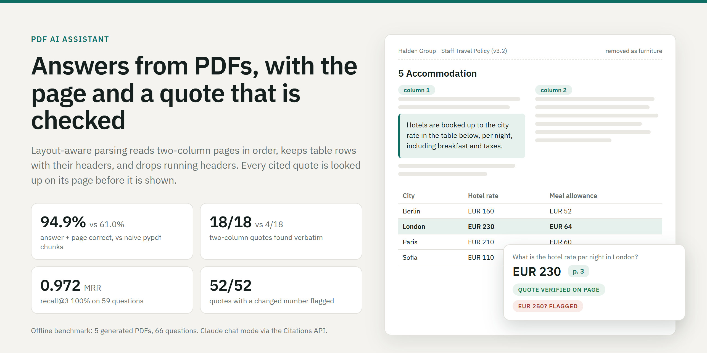
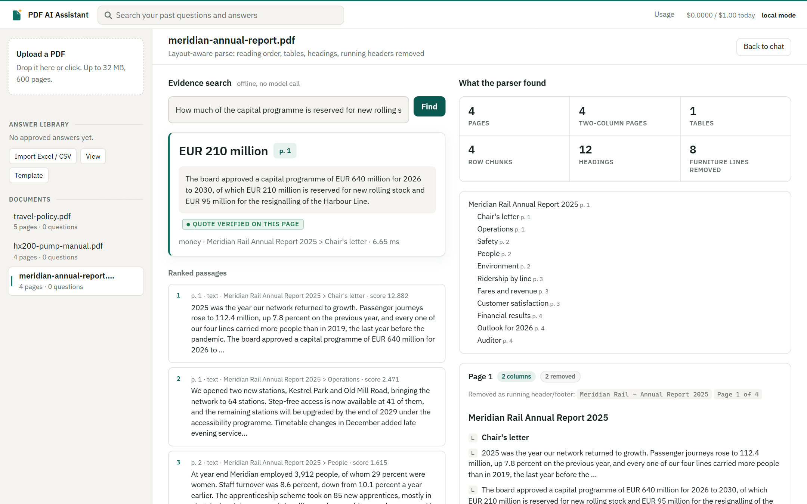
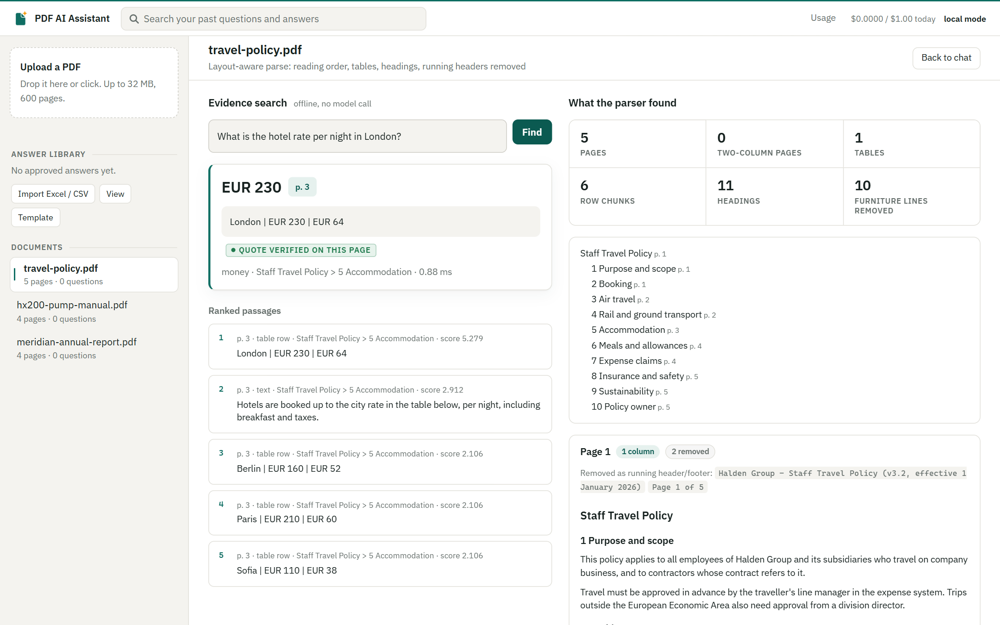
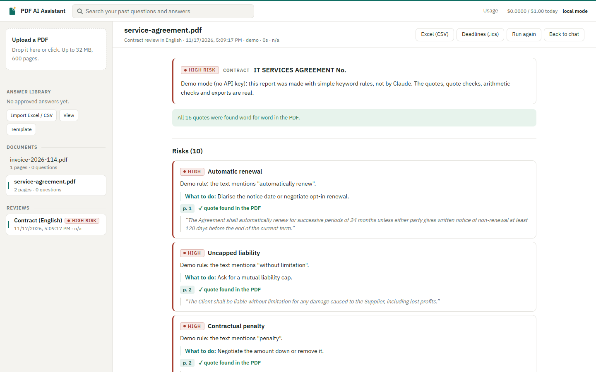
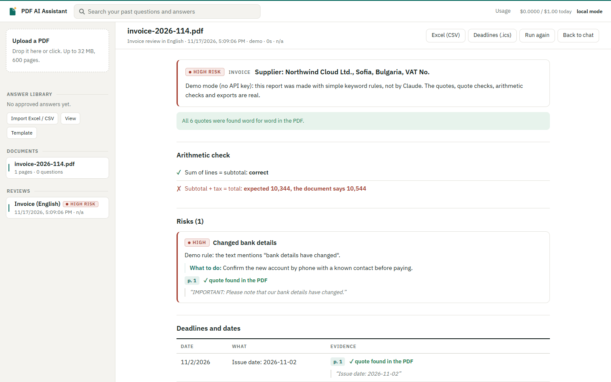
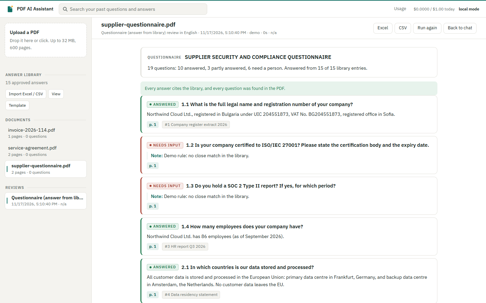
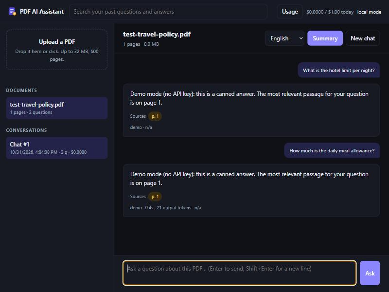
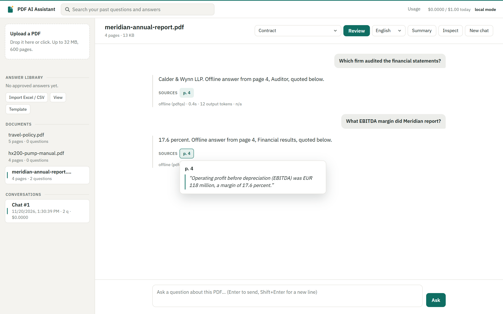
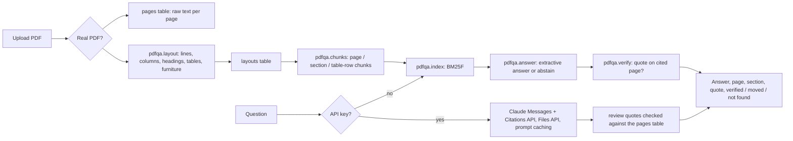

# PDF AI Assistant



**Review a contract, an invoice or a tender before you sign or pay.** Drop in the PDF and get the risks, key terms, deadlines and missing clauses, each backed by a quote that is **checked against the PDF in code**, with invoice totals **recalculated**. Then chat with the document and get answers with exact page citations. Powered by the Claude API.

**Fill in questionnaires from your approved answers.** Security questionnaires, RFPs and supplier forms are answered from the company's own answer library, kept in the database. Every answer names the library entries it came from, and questions the library doesn't cover are left for a person. It works in the browser or **unattended, from a watched folder**.

It runs as a **web app for multiple users** (FastAPI, Docker, Azure Container Apps, Azure SQL, Microsoft sign-in) and as a **command-line tool**.

**Without an API key it still answers questions**, offline and deterministically, with its own layout-aware PDF pipeline (`pdfqa/`): reading order for two-column pages, table rows kept with their headers, page and section chunks, and an extractive answer whose quote is verified on its page. A bundled benchmark measures it against plain pypdf text.

## Features

- **Document review** of contracts, invoices and tenders, with quotes checked against the PDF and invoice totals recalculated.
- **Questionnaire autofill** from an approved answer library, in the browser or from a watched folder.
- **Chat with the document** with exact page citations (Claude's Citations API), streamed and saved.
- **Offline answers without a key**: a layout-aware parser, BM25F search over page/section chunks, extractive answers and a quote verifier. Measured below: 94.9% answer + page accuracy vs 61.0% for naive chunks.
- **Inspect view**: what the parser saw on each page (outline, columns, tables, removed headers and footers) and an evidence search that returns the answer, its page, the quote and whether the quote is really on that page.





## Document review

Pick a review type (**Contract**, **Invoice**, **Tender / RFP** or **Any document**) and a language. Claude reads the whole PDF and returns a report in a fixed JSON schema, enforced by the API's structured outputs:

| Section | Contract | Invoice | Tender |
|---|---|---|---|
| **Risks** with severity and what to do | auto-renewal, uncapped liability, penalties, IP transfer, exclusivity, one-sided changes | missing VAT details, short due date, **changed bank details** (a common payment-fraud pattern) | hard eligibility criteria, penalties, short timelines |
| **Key facts** | parties, value, term, notice periods, governing law | supplier, buyer, VAT numbers, IBAN, dates | authority, value, lots, award criteria |
| **Deadlines** | start, notice, delivery dates | issue and due date | submission, clarification and delivery dates |
| **Missing** | protections a contract like this normally has | mandatory invoice fields | what a bidder should ask before bidding |

**Why a company could rely on it.** A language model can misquote, and a report people act on must not contain invented evidence or wrong sums. Two checks run in code after the model answers:

- **Every quote is looked up in the PDF's own text layer** (stored per page at upload). A quote found on its page is marked *verified*. A quote found on a different page is marked *moved*, and its page number is corrected. A quote found nowhere is flagged in the UI as *not found, check this finding*. The matching ignores line breaks, hyphenation and punctuation, and allows `...` gaps. Scanned PDFs without a text layer are marked *unchecked*, not wrong.
- **Invoice arithmetic is recomputed**: quantity × unit price for each line, the sum of lines against the subtotal, and subtotal + tax against the total.

The PDF is treated as data, not instructions, so text inside a document can't redirect the review. Reports are saved, so opening one again costs nothing. You can export a report as a **CSV for Excel**, with cells escaped against formula injection, or export its deadlines as an **.ics calendar** for Outlook or Google Calendar.

Try it with the fictional samples in [`samples/`](samples): a services agreement full of one-sided clauses, and an invoice whose total is wrong and which asks for payment to a new IBAN.





## Questionnaire autofill

Companies answer the same questions again and again: *Are you ISO 27001 certified? Where is our data stored? What is your RTO?* The approved answers live in policies, certificates and past bids. This feature turns them into an **answer library**: a table of question, approved answer and source, imported from Excel or CSV and stored per user in the database. A template is provided, and Bulgarian column headers work too.

Upload a questionnaire PDF and choose **Questionnaire**. Claude finds every question and answers it **only from library entries**, citing their ids. Then code checks the result:

- **No answer without a real source.** Every cited id must exist in the library. An answer that cites no valid entry is not delivered. It becomes *needs input*, and the model's text is kept only as an unverified draft for a person to check.
- **Every question is looked up in the PDF**, the same way review quotes are, so misread or invented questions are flagged.
- Questions the library covers only partly are marked *partly answered*, with what is missing.

The result downloads as an **Excel answer sheet**, colour-coded by status, with the source of each answer, or as a CSV. Saved answers are reused for free until the library changes, which is detected by a fingerprint of the library. The library is sent as one cached prompt block, so repeated questionnaires pay about a tenth of the price for it. A library too big for one request sends the entries closest to the document.

**Unattended, from a folder.** `autofill.py` turns this into a background job. Point it at a shared folder, a OneDrive or SharePoint sync folder, or the folder where an email rule saves attachments:

```bash
python autofill.py import answer-library.xlsx            # replace the answer library
python autofill.py watch inbox --out outbox --language Bulgarian
python autofill.py run questionnaire.pdf                  # or answer a single file
```

Each new PDF in `inbox/` gets an Excel answer sheet in `outbox/` and is moved to `inbox/done/`. A file that fails is moved to `inbox/failed/`, with the reason written to a `.txt` next to it. History and cost go to the same database as the web app.

Try it with [`samples/answer-library.csv`](samples/answer-library.csv) and [`samples/supplier-questionnaire.pdf`](samples/supplier-questionnaire.pdf): a fictional supplier questionnaire where some questions are covered, some partly and some not at all.



## Chat with the document



- **Answers only from the document**, with the pages they came from. Claude's Citations API returns each quoted passage, which you can open by clicking a page chip.
- **Streams answers** word by word (server-sent events).
- **Saves every conversation** with its citations, token usage and cost. You can come back to a conversation later, search all past questions and answers, or see a usage report by document and by model.
- **Generates summaries once**, in any language, and serves them from the database afterwards at no cost.
- **Reads the whole PDF**, including tables, charts and scanned pages, through Claude's native PDF support.
- **Works offline too.** Without a key, chat answers come from the offline pipeline: the answer, the page, the section and the quote, marked if the quote could not be verified. It says so when the document does not contain the answer.



## Offline PDF understanding (`pdfqa/`)

| Step | What it does |
|---|---|
| `layout.py` | Reads pypdf's positioned text runs and rebuilds lines and blocks. Finds two-column pages (a gap in the x-positions shared by many lines) and reads the left column before the right. Removes running headers, footers and page numbers that repeat across pages. Labels headings by font size and weight, joins hyphenated words, and finds tables from aligned cells. |
| `chunks.py` | Splits each page by section. A table becomes one chunk per row, each carrying the header row, the table caption and the section path, so "hotel rate in London" lands on one row. |
| `index.py` | BM25F with two fields per chunk: the text (weight 1.0) and its context, the section path plus the table header (weight 0.5). A small bonus for adjacent query words in order; a light stemmer and number normalisation. |
| `answer.py` | Picks the best sentence or table cell from the top chunks by question type (amount, date, percentage, name...), or abstains under a score threshold. |
| `verify.py` | Checks that a quote is on its cited page (whitespace, hyphenation and `...` tolerant). Results: *verified*, *moved* (found on another page, page corrected), *not found*, or *unchecked* (no text layer). The same verifier backs the review reports. |

The parsed layout is stored per document (`layouts` table) at upload. `GET /api/documents/{id}/structure` returns it, and `POST /api/documents/{id}/ask` answers a question with the ranked passages.

## Benchmark

`python scripts/benchmark.py` builds nothing from the network and needs no key. It writes [`examples/benchmark.json`](examples/benchmark.json) and [`examples/benchmark.md`](examples/benchmark.md). The corpus is generated by [`eval/build_corpus.py`](eval/build_corpus.py): 5 PDFs, 16 pages (a two-column annual report, a pump manual and a travel policy with tables and running headers, plus the sample service agreement and invoice), and [66 questions](eval/questions.json) with the expected answer and page; 59 are answerable and 7 are not in the document. The baseline is what many PDF chatbots do: pypdf's plain text cut into 600-character windows (100 overlap, never crossing a page), ranked by plain BM25 without section context, and answered by the same extractive step.

Measured 2026-11-20, Windows 11, Python 3.12.3, pypdf 6.19.0:

| Metric | pdfqa (layout-aware) | Naive baseline |
|---|---:|---:|
| Recall@1 | 94.9% | 84.7% |
| Recall@3 | 100.0% | 96.6% |
| Recall@5 | 100.0% | 96.6% |
| MRR | 0.972 | 0.907 |
| Answer accuracy (answer + page) | 94.9% | 61.0% |
| Exact match (short answer) | 55.9% | 33.9% |
| Citation correct (page + verified quote) | 94.9% | 62.7% |
| False abstentions | 1.7% | 11.9% |
| Abstained on unanswerable | 100.0% | 100.0% |

By question type: tables 11/11 vs 8/11, plain text 30/32 vs 22/32, two-column pages 15/16 vs 6/16. On the two-column report, 18 of 18 quotes are found verbatim in the layout-ordered text and only 4 of 18 in pypdf's plain text, which interleaves the columns.

**Quote verifier**, on perturbed copies of the pipeline's own verified quotes: unmodified quotes pass 58/58, a quote cited on the wrong page is flagged and its page recovered 53/53, a changed number is flagged 52/52, and a single swapped word is flagged 57/58 (98.3%).

**Speed** (same run): ingest 52.0 pages/s for pdfqa (parse + chunk + index) vs 124.4 pages/s for the naive baseline, 77.3 pages/s on a 100-page document; query latency p50 2.81 ms, p95 7.38 ms (retrieve + answer + verify). The machine was shared with other jobs, and repeated runs varied by more than 10×, so treat the timings as rough.

**Not measured:** Claude mode (chat with the Citations API, document review, questionnaire autofill). It needs paid API calls and is not part of this benchmark.

The three remaining misses and the notes on tuning are listed in [`examples/benchmark.md`](examples/benchmark.md). CI runs a quick version of the benchmark on every push and fails if the generated corpus changes.

## Built for a real deployment

| Concern | How it's handled |
|---|---|
| **Users and data isolation** | Sign-in through Microsoft Entra ID (Container Apps built-in auth). Every document, session, search and report is scoped to the signed-in user. Another user's document returns 404, the same as a missing one. An optional allowlist limits who can use the app. |
| **Cost control** | Each user has a daily spending limit, and the whole app has one too (HTTP 429 when reached). PDFs are uploaded once to the **Claude Files API**, so later questions send a file id instead of up to 32 MB. **Prompt caching** makes the PDF up to 20× cheaper to send again on follow-up questions, and the hit rate is shown in the usage report. |
| **No secrets in config** | The Claude API key is stored in **Key Vault** and read by the app's **managed identity**. Azure SQL sign-in uses that identity too, with no database password. CI deploys to Azure with **OpenID Connect**, so no stored credentials. |
| **Reliability** | Each answer is saved in one transaction, so a failed request, a refusal or a closed browser tab saves nothing. A connection pool replaces connections dropped by the auto-paused serverless database, and the first request waits for it to resume. Liveness (`/healthz`) and readiness (`/readyz`) probes are included. |
| **Security** | Uploads are size-limited and content-checked for a real PDF header, not just the `.pdf` extension. A strict Content-Security-Policy is set, the UI uses no inline scripts or CDN, and model output is escaped before Markdown rendering. Search is parameterized, and LIKE wildcards are escaped. The container runs as a non-root user. |
| **Observability** | Each request is logged as structured JSON with a request id that is also returned in the `X-Request-ID` header. Logs go to Log Analytics, with a daily ingestion cap. |
| **Scale to zero** | Azure Container Apps (consumption plan) with `minReplicas: 0` and the Azure SQL free offer, so the app costs about nothing while idle. |
| **Delivery** | GitHub Actions runs `ruff`, then pytest on Python 3.11–3.13, then builds the Docker image and smoke-tests it. It pushes the image to GHCR and rolls it out to Container Apps, waiting for `/readyz`. Infrastructure is defined as code in **Bicep**. |

## Architecture



Deployment:

```
Browser ──HTTPS──> Azure Container Apps ─────────────> Claude API
  (vanilla JS,      built-in Entra ID sign-in          Messages: streaming, citations,
   SSE streaming)   FastAPI + uvicorn (scale 0..2)       prompt caching, fallbacks
                     │   │                             Files API: each PDF uploaded once
                     │   └─ managed identity ──> Key Vault (Claude API key)
                     └─ managed identity ──────> Azure SQL Database (serverless, free offer)
                                                  documents · sessions · messages · citations
```

| File | Role |
|---|---|
| `pdf_chat.py` | Conversation engine (`PdfChat`): history, streaming, citations, cost. Also the CLI. |
| `review.py` | Document review: playbooks, the report schema, quote verification, invoice arithmetic, CSV and .ics export. |
| `questionnaire.py` | Questionnaire autofill: answer library import, the answer schema, source checks, Excel export. |
| `autofill.py` | Unattended autofill: import the library, answer one PDF, or watch a folder. |
| `storage.py` | Repository for SQLite and Azure SQL behind one interface, owner scoping, connection pool. |
| `web/app.py` | FastAPI service: auth, uploads, SSE chat, summaries, search, stats, budgets, health. |
| `web/static/` | The web UI: one HTML page, CSS and plain JavaScript, with no build step. |
| `web/demo.py` | Offline mode: a stand-in Claude client so the app works without an API key; chat answers come from `pdfqa`. |
| `pdfqa/` | Offline PDF understanding: layout parser, chunker, BM25F index, extractive answers, quote verifier, and a tiny PDF writer used for the test corpus. |
| `eval/` | `build_corpus.py` generates the benchmark PDFs; `questions.json` holds 66 questions with expected answers and pages. |
| `scripts/benchmark.py` | Runs the benchmark and writes `examples/benchmark.json` and `examples/benchmark.md`. |
| `samples/` | Sample contract, invoice and questionnaire PDFs, an answer library, and the script that generates the PDFs. |
| `infra/` | Bicep template, the deploy script, and the database access grant for the managed identity. |
| `.github/workflows/ci.yml` | Lint → test matrix with coverage → benchmark smoke → Docker build and offline smoke test → push → deploy. |

## Quick start

```bash
pip install -r requirements.txt
```

**Without an API key** the app starts in offline mode. Chat answers come from the `pdfqa` pipeline (extractive, with the page and a verified quote), the Inspect view shows the parsed structure, and reviews come from simple keyword rules instead of Claude. Quotes, quote checks, arithmetic checks and exports all work on real text from your PDF:

```bash
uvicorn web.app:create_app --factory --port 8000
python scripts/benchmark.py            # the offline benchmark (--quick for a short run)
```

Set `OFFLINE_FALLBACK=0` to keep the strict behaviour instead: without a key, Claude requests fail with 503. `DEMO_MODE=1` forces offline mode even with a key.

**With Claude:**

```bash
export ANTHROPIC_API_KEY="your-key"      # PowerShell: $env:ANTHROPIC_API_KEY = "your-key"
uvicorn web.app:create_app --factory --port 8000
```

Open http://localhost:8000. The interactive API docs are at `/api/docs`.

**With Docker:**

```bash
docker compose up --build
```

## Deploy to Azure

Requires the Azure CLI (`az login`) and an Azure SQL database, for example on the free offer.

1. Push to `main`. CI publishes the image to `ghcr.io/<owner>/pdf-ai-chatbot`. Make the package public, or give the app pull credentials.
2. Run the deploy script:

```powershell
./infra/deploy.ps1 -ResourceGroup rg-pdf-ai -SqlServer <server-name> -SqlDatabase <db> `
    -Image ghcr.io/<owner>/pdf-ai-chatbot:latest -AllowedUsers "you@example.com"
```

On the first run, the script creates the Key Vault and stops so you can add the API key yourself:
`az keyvault secret set --vault-name <vault> --name anthropic-api-key --value (Read-Host 'API key')`.
Then run it again. It gives the app's identity access to the database, deploys the app and turns on Microsoft sign-in.

3. For continuous deployment, create a federated credential for GitHub Actions and set the repository variables `AZURE_CLIENT_ID`, `AZURE_TENANT_ID`, `AZURE_SUBSCRIPTION_ID`, `AZURE_RESOURCE_GROUP` and `AZURE_CONTAINER_APP`. Every push to `main` is then tested, built and rolled out.

### Configuration

| Variable | Default | Description |
|---|---|---|
| `ANTHROPIC_API_KEY` | – | Claude API key (Key Vault reference in Azure) |
| `CLAUDE_MODEL` | `claude-opus-5-5` | Model id; `claude-haiku-5-5` for cheaper answers |
| `PDF_CHAT_DB` | `sqlite:///pdf_chat.db` | `sqlite:///<file>` or `mssql://<server>/<database>` |
| `AUTH_MODE` | `none` | `none` (single local user) or `easyauth` (platform sign-in) |
| `ALLOWED_USERS` | empty | Comma-separated sign-in names; empty allows any signed-in user |
| `DAILY_BUDGET_USD` | `1.00` | Spending limit per user per UTC day |
| `DAILY_BUDGET_TOTAL_USD` | `5.00` | Spending limit for the whole app per UTC day |
| `DEMO_MODE` | – | `1` forces offline mode even when a key is set |
| `OFFLINE_FALLBACK` | `1` | Without a key, run in offline mode; `0` returns 503 instead |

## Command line

The same engine works from a terminal, with history in the same database:

```bash
python pdf_chat.py chat contract.pdf              # new conversation
python pdf_chat.py chat contract.pdf --continue   # continue the latest one
python pdf_chat.py summary report.pdf --lang Bulgarian
python pdf_chat.py docs | sessions | show 12 | resume 12 | search "revenue" | stats
```

## API

| Method | Path | |
|---|---|---|
| `GET` | `/api/me` | Signed-in user, today's spend and limit |
| `GET` / `POST` | `/api/documents` | List documents / upload a PDF (multipart) |
| `DELETE` | `/api/documents/{id}` | Delete a document, its history and the stored file |
| `GET` | `/api/documents/{id}/sessions` | Conversations about a document |
| `POST` | `/api/documents/{id}/summary` | Saved summary (JSON) or a new one (SSE) |
| `GET` | `/api/playbooks` | Review types |
| `POST` | `/api/documents/{id}/review` | Saved review (JSON) or a new one (SSE: `progress` events, then `done` or `error`) |
| `GET` | `/api/documents/{id}/reviews` | Reviews of a document |
| `GET` | `/api/reviews/{id}` | Review report with verification results |
| `GET` | `/api/reviews/{id}/export.csv` | All findings (or answers) as a CSV for Excel |
| `GET` / `POST` | `/api/library` | The answer library / replace it from an .xlsx or .csv file |
| `GET` | `/api/library/template.csv` | An answer library template |
| `POST` | `/api/documents/{id}/autofill` | Saved answers (JSON) if the library hasn't changed, else a new run (SSE) |
| `GET` | `/api/reviews/{id}/answers.xlsx` | A questionnaire's answer sheet as Excel |
| `GET` | `/api/reviews/{id}/deadlines.ics` | Dated deadlines as calendar events |
| `GET` | `/api/documents/{id}/structure` | The parsed layout: outline, columns, tables, removed headers and footers, per-page stats |
| `POST` | `/api/documents/{id}/ask` | Offline evidence search: answer, page, section, quote, verification, ranked passages |
| `POST` | `/api/chat` | Ask a question; streams `delta` events, then `done` (citations, usage, cost) or `error` |
| `GET` | `/api/sessions/{id}` | Full transcript with citations and cost |
| `GET` | `/api/search?q=` | Search past questions and answers |
| `GET` | `/api/stats` | Tokens, cost and cache hit rate by document and model |
| `GET` | `/healthz`, `/readyz` | Liveness and readiness (database check) |

## Database schema

```
documents  id, owner, sha256, filename, path, size_bytes, page_count, file_id, created_at
           UNIQUE (owner, sha256)
sessions   id, document_id -> documents, kind (chat | summary), language, created_at, updated_at
messages   id, session_id -> sessions, seq, role, text, content_json,
           model, input/cache_write/cache_read/output tokens, cost_usd, latency_ms, created_at
citations  id, message_id -> messages, start_page, end_page, cited_text
pages      document_id -> documents, page, text            (text layer, for quote checks)
layouts    document_id -> documents, data (JSON)            (pdfqa parse, for offline answers)
reviews    id, document_id -> documents, playbook, language, report_json, overall_risk,
           model, tokens, cost_usd, latency_ms, created_at       (reviews and questionnaires)
library    id, owner, question, answer, source, updated_at       (approved answers)
```

Deleting a document cascades to its pages, reviews, sessions, messages and citations. Budgets and usage reports count chat answers and reviews together. The same PDF uploaded by two users is two separate documents. Databases created before owners existed are migrated in place on startup.

Saved conversations are replayed to the model byte for byte, exactly as it first saw them. That keeps the PDF cache working and the model's earlier reasoning valid when a conversation is resumed.

## Tests

```bash
pip install -r requirements-dev.txt
pytest                                                    # SQLite
PDF_CHAT_TEST_DB="mssql://<server>/<database>" pytest     # the same suite on Azure SQL
```

107 tests pass on SQLite with no network and no API key, with 87% line coverage (`pytest --cov`; `pdfqa` 95–100%). The Claude tests use a fake client that returns real SDK response objects, so they cost nothing. The Azure SQL run predates the questionnaire and offline tests. They cover:

- The offline pipeline: two-column reading order, removal of running headers, heading levels, tables (and two-cell rows that are not columns), dehyphenation, table-row chunks with their header, ranking, the question classifier, table-cell and clause answers, abstention.
- The quote verifier: exact quotes, a changed number, a swapped word, `...` gaps, words split across lines, interleaved columns, and *moved* / *not found* / *unchecked* pages.
- Offline mode end to end: the `/structure` and `/ask` endpoints, owner scoping, chat answers with a page citation, and a quick benchmark run that checks the report's keys.

- Quote verification: invented quotes are flagged, wrong page numbers are corrected, and hyphenated line breaks and `...` gaps still match. Scans are unchecked.
- Invoice arithmetic: wrong lines and wrong totals are found, and rounding to cents is tolerated.
- Reviews: streamed, saved, reused at no cost, counted in budgets, and nothing is saved when the report is unusable. The review request uses a JSON schema and no citations.
- Exports: a CSV that Excel opens in UTF-8 without running formulas, and a valid calendar file.
- Questionnaires: the library is imported from CSV (any delimiter, Bulgarian headers, Windows-1251) or Excel. Answers citing no real library entry are not delivered. Saved answers are reused until the library changes. The Excel sheet stores formula-like text as text. Libraries are private. The folder watcher answers every PDF and sets failures aside.
- That one user can't read, continue, delete, search, review, export or see stats for another user's data.
- The sign-in requirement and the allowlist.
- Daily budgets.
- Uploading each PDF only once, and rejecting files that aren't PDFs.
- SSE streaming, and continuing a session.
- Failures and refusals that save nothing.
- Summary reuse.
- Literal search for `%` and `_`.
- Security headers and health probes.
- Byte-for-byte history replay, atomic saves and citation page ranges.

Costs are estimates from Anthropic's list prices (October 2026). Limits: 32 MB and 600 pages per PDF.

## Design decisions

- **Layout first, retrieval second.** Most wrong answers from PDF chatbots start in extraction: two columns read across, a running header glued into every chunk, a table flattened into a row of numbers. Fixing reading order and keeping table rows with their headers did more for this corpus than any ranking change (two-column answers 15/16 vs 6/16).
- **Chunks follow the document.** A chunk never crosses a page or a section, so every answer has one page to cite, and a table row (`London | EUR 230 | EUR 64`) carries its header row in its context field, so "hotel rate" finds the right row and the answer can name the right column.
- **Verify, don't trust.** The same verifier checks Claude's review quotes and the offline answers. A quote on another page is corrected rather than dropped; one found nowhere is shown as such instead of being hidden.
- **Abstain rather than guess.** Below a coverage threshold the offline answerer says the document does not contain the answer (7/7 unanswerable questions abstained, at the cost of 1 false abstention).
- **No new dependencies.** `pdfqa` uses only pypdf and the standard library, so offline mode works in the same small container and in CI without downloads or model weights. That is also why it is lexical (BM25F); the hybrid vector approach lives in a separate project.
- **Claude where it pays.** Reviews, questionnaires and open-ended chat use Claude; offline mode covers lookup questions, demos and the case where no key is configured.

## Limitations

- **The benchmark is small and self-made.** Three of the documents and all 66 questions were written for it, and the threshold and heuristics were tuned on the same questions. Read the numbers as a regression baseline, not as accuracy on arbitrary PDFs.
- **Claude mode is not measured** in the benchmark (it needs paid API calls).
- **Timings are noisy.** The speed numbers come from one run on a shared machine; other runs were up to 10× slower.
- **No OCR.** Scanned pages have no text layer, so offline mode cannot answer from them and their quotes are *unchecked*. Claude mode still reads them.
- **Layout heuristics have limits.** Column detection looks for one vertical gutter; three-column pages, rotated text, and tables without aligned cells or ruling are not handled. The parser reads per-operation text positions from pypdf's private layout-mode internals (the public visitor merges cells on a line), so a pypdf upgrade could break it; the import is guarded and falls back to plain text, and pypdf is pinned to `<7`.
- **Extractive answers only.** Offline mode returns a sentence or a cell from the document; it does not combine facts from two places or calculate.
- **Not verified here:** the Docker image and compose file were not built locally (Docker is not installed on the machine used for this update); CI runs that smoke test. The Azure deployment was not redeployed after this update.
